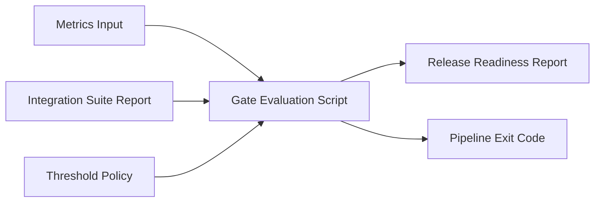

# CI/CD Quality Gates

A runnable reference implementation of release quality gates: feed it metrics (smoke results, performance numbers, accessibility violations, static analysis) plus an optional integration-suite report, and it produces an explicit **PASS**, **WARN**, or **BLOCK** decision with an auditable readiness report.

The point is to turn "are we ready to release?" from a meeting into a script.

## Architecture



## Quick Start

```bash
./run-tests.sh
```

Windows:

```powershell
python scripts\evaluate_gates.py sample-data\metrics.json
```

With an integration-suite report as second input (samples in `sample-data/`; the warn sample also contains a blocked scenario, so it reports BLOCK — see the note under "What's Inside"):

```powershell
python scripts\evaluate_gates.py sample-data\metrics.json sample-data\integration-suite-report-pass.json
```

## How It Decides

Thresholds live in `gates/thresholds/` (JSON + YAML) and are evaluated in `scripts/evaluate_gates.py`:

- Any hard failure (smoke, latency/error-rate/throughput breach, accessibility criticals, analysis blockers) → **BLOCK**
- Integration suite warnings with no hard failures → **WARN**
- Clean across the board → **PASS**

The exit code mirrors the decision, so it drops straight into any pipeline.

## What's Inside

- `scripts/evaluate_gates.py` — the evaluator
- `gates/thresholds/` — performance thresholds and quality policy
- `sample-data/` — pass and warn integration-suite reports you can run as-is. Note: the warn report's `finalDecision` is WARN, but it contains one BLOCK scenario (schema-drift), and the evaluator escalates per scenario — so running it reports BLOCK and exits 1. There is no separate block sample file; pure-WARN escalation (a warning with no blocked scenario) is covered by the unit tests instead.
- `ci/` — GitLab CI and Jenkins pipeline templates
- `docs/` — policy notes and evidence

## What's implemented

- **Unit tests** — `tests/test_evaluate_gates.py`: 18 pytest tests covering threshold boundaries and escalation rules
- **JUnit XML reports** — `python scripts/evaluate_gates.py --junit reports/junit.xml` for pipeline integration
- **HTML reports** — `python scripts/evaluate_gates.py --html reports/readiness.html`; self-contained, open directly in a browser
- **JSON + Markdown** — `reports/release-readiness.json` (machine-readable) and `reports/release-readiness.md` (human-readable); the Markdown also renders inline in the GitHub Actions run summary
- **GitHub Actions** — live workflow in `.github/workflows/ci.yml` (runs pytest plus both sample evaluations on push/PR); reference copy kept in `ci/github-actions.yml`; uploads readiness reports as build artifacts

## Roadmap

- Custom threshold policies per service

## License

MIT — see [LICENSE](LICENSE).
